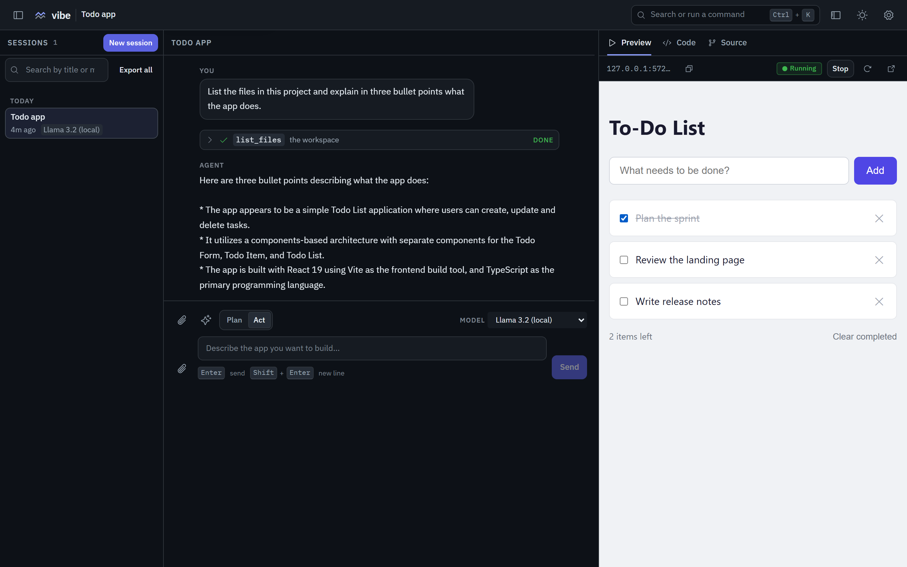
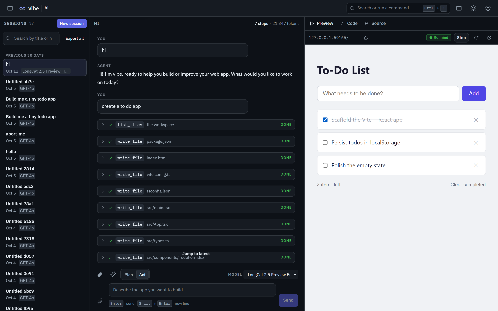
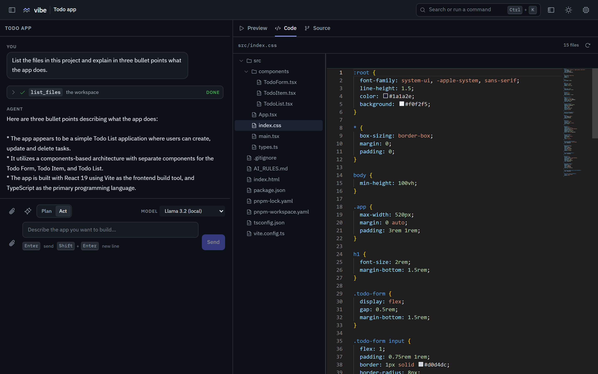

# vibe

[](https://github.com/ahmadmhmdsy/vibe/actions/workflows/ci.yml)

**A local-first vibe-coding IDE.** Describe an app in the chat box; an agent writes it as a
multi-file React project, installs it, builds it, runs it, and keeps it working in a live preview.



vibe runs entirely on your machine. The React UI talks to a FastAPI + LangGraph backend that drives
a real Vite + React + TypeScript project in a workspace directory on disk. You watch the agent's
tool calls arrive in a timeline, the app take shape in the preview iframe, and the generated source
land in the code panel. Build output and browser console errors feed back to the agent, which fixes
them and tries again.

No account, no cloud service, no telemetry. By default the API listens on loopback only; apart from
the Monaco editor CDN the code view loads, the only outbound traffic is the model provider you
configure and the package downloads a generated app needs.

vibe is **Windows-first** today: the one-click launchers are `.bat` files and CI runs on
`windows-latest`.

Quick start: [Requirements](#requirements) · [Install](#install) · [Run](#run) ·
[Local setup guide](docs/guides/local-setup.md)

## What you get

### Chat with a live tool timeline

Messages stream over Server-Sent Events; a reconnect resumes from the last event sequence number,
so a dropped connection neither loses nor duplicates the transcript. Tool calls and results are
paired with running / ok / error state, and installs outside the allowlist appear as approval cards.
A **Stop** control interrupts an in-flight run, and the header shows session usage: steps, tokens,
and estimated USD cost, with a per-model breakdown.

### Live preview

The preview panel starts and stops the generated app's Vite dev server, reloads the iframe, and
copies the preview URL. While the tab is visible it polls the backend for the server's state, so
the badge reflects what is actually running.



### Code view

The code panel shows the workspace as a file tree beside a Monaco editor. The tree polls for files
the agent writes; edits you save go through the API and are used by the next build. The editor
follows the app theme.



### Source control

Each session's workspace gets a source-control panel: initialize a git repository, review status and
a diff, commit with a message, create or switch branches, read recent commits. Nothing pushes
anywhere - a remote is your decision, not a side effect.

### Start from nothing or from code you already have

A new session's project can be **empty** (the agent writes everything), the **built-in template** (a
runnable Vite + React + TypeScript app), **a folder on this machine** (opened in place, never moved
or copied), or **a git repository** (cloned into the session workspace).

### Providers and settings

Built-in providers are OpenAI, Anthropic, and OpenCode Go. Custom providers cover any OpenAI- or
Anthropic-compatible endpoint: name, protocol, base URL, key, and models. The UI only ever learns
whether a key is configured - the catalog returns masked status, not keys or base URLs.
**Settings -> System prompt** edits the standing instructions the agent starts from.

### Sessions, onboarding, and recovery

The sidebar creates, renames, resumes, and deletes sessions; a deleted workspace moves to
`<workspace_dir>\.trash` instead of being erased. With no provider configured, the first-run panel
says exactly what is missing and offers example prompts. Small conveniences are there too: dark and
light themes, a command palette (Ctrl/Cmd+K), a shortcut reference (press `?`), and a three-pane
layout that collapses into drawers on narrow screens.

## Architecture

```
Browser (React 19 + TypeScript SPA)
   │  HTTP + Server-Sent Events (typed events, resume from after_seq)
   ▼
FastAPI (services/vibe)
   ├── LangGraph agent runtime ── ToolRegistry ── local executor + Playwright
   ├── LLM providers (OpenAI / Anthropic / OpenCode Go / custom endpoints)
   └── SQLite sessions.db + events.db · per-session workspace on disk
```

- **Frontend** - React 19 + TypeScript + Vite 6. Each feature under `src/features/` owns its
  components, Zustand store, styles, and tests; `src/App.tsx` composes them. One typed API client
  and one SSE client are the only way out.
- **Backend** - FastAPI behind a dependency-injected container that builds the seams:
  `AgentRuntime` (LangGraph today), `LlmProvider` adapters, `Executor` (local subprocess),
  `ToolRegistry`, `SessionStore`, and an append-only `EventLog`.
- **Persistence** - two SQLite databases under the workspace: sessions, and per-session event
  history. The transcript is rebuilt from the log; live text chunks are ephemeral and settled by
  the stored assistant message.
- **Execution** - the local executor runs `pnpm install`, `vite build`, and `vite dev` as
  subprocesses with timeouts and truncated output; headless Chromium (Playwright) supplies console
  text and screenshots.
- **Security** - loopback bind by default; every route except `/health` is authenticated, and
  state-changing requests must carry a trusted `Origin`. Agent file tools resolve paths and reject
  anything outside the session workspace; package installs stay on an allowlist unless you approve
  them.
- **One port in production** - the backend serves the built SPA and the API from a single process,
  so the browser sees one origin. In dev mode Vite owns the frontend with hot reload and the API
  answers cross-origin.

## The agent loop

1. Your message is appended to the session's event log and sent to the runtime.
2. A LangGraph graph alternates `call_model` and `execute_tools` until the model stops calling
   tools. Text and tool activity stream out as typed events.
3. Tools run against the workspace and the executor: write and edit files, install packages, build,
   start or stop the dev server, read the browser console, take a screenshot.
4. Every durable result is logged and broadcast; the UI folds the event stream into the transcript.
5. **Auto-run verifies the result.** If files changed, the policy builds the app. A build failure
   becomes a synthetic fix turn - *"The app failed: <details>. Fix it."* - and the loop repeats. A
   successful build starts the dev server, reads the console, and feeds runtime errors back the same
   way.
6. The loop stops at a clean build and console, after the configured number of fix attempts
   (`VIBE_MAX_FIX_ITERATIONS`, default 3), at the session token budget if one is set, or when you
   press Stop.

| Tool | What it does | Guardrails |
|---|---|---|
| `write_file` / `edit_file` / `read_file` / `list_files` | create, edit, read, and list project files | resolved and rejected outside the session workspace; bounded reads and listings |
| `install_deps` | install npm packages | starter allowlist; anything else needs your approval in chat |
| `build` | run `vite build` | timeout, output truncation |
| `run_dev_server` / `stop_dev_server` | start and stop the preview | stopped on session delete, idle timeout, or shutdown |
| `read_console_logs` | browser console and page errors | reports "unavailable" rather than pretending the console was clean |
| `screenshot` | capture the running app | returned to the model as an image |

## Tech stack

| Area | Stack |
|---|---|
| Frontend | React 19, TypeScript, Vite 6, Zustand 5, Monaco editor, Vitest + Testing Library |
| Backend | Python 3.13, FastAPI, Pydantic 2, LangGraph 1.2, LangChain (OpenAI / Anthropic), SQLite, Playwright |
| Tooling | pnpm 12 workspace, uv, ruff, ESLint, Prettier, pytest |
| CI | GitHub Actions on `windows-latest` |

## Project layout

```
apps/vibe/                 React SPA: src/{app,features,components,lib,hooks,styles}, dist/
services/vibe/             FastAPI backend: src/vibe/{api,runtime,executor,tools,providers,
                           autorun,services}, tests/
docs/                      guides, architecture, reviews, research, design spec
scripts/                   acceptance-local.ps1, release-check.ps1
.github/workflows/         ci.yml, acceptance.yml
start.bat  stop.bat  doctor.bat  test.bat
```

## Requirements

- **Python 3.13+** - required by `services/vibe/pyproject.toml`; blocking in the doctor.
- **Node 20+** - this repo and CI use Node 24; the doctor blocks anything below 20.
- **pnpm 12.3.4** - pinned by `packageManager` in `package.json`; the doctor requires it on PATH.
- **uv** - creates and updates the backend venv; an optional doctor warning once the venv exists.
- **Playwright Chromium** - optional, but without it the agent cannot read console logs or take screenshots.
- **Free ports 7321 (API) and 5173 (Vite dev)** - both are blocking doctor checks.

## Install

```bat
git clone https://github.com/ahmadmhmdsy/vibe.git
cd vibe
```

Run these once from the repository root. They download packages, so they need a network connection.

```bat
cd services\vibe
uv sync --extra dev
.venv\Scripts\python.exe -m playwright install chromium
cd ..\..
pnpm install
pnpm run build
```

`pnpm run build` compiles the frontend into `apps\vibe\dist`; the one-click run serves that build
from the backend on a single port. Without it, `start.bat` exits with a `RuntimeError` whose message
says the built frontend is missing and asks you to run `pnpm run build`. Then check the machine:

```bat
doctor.bat
```

It prints one `PASS`/`FAIL` line per prerequisite and the exact fix under each failure.

## Run

**Double-click `start.bat`** (or run it from a terminal). That is the one command. It runs the
doctor and stops on a blocking failure, picks the first free port from 7321 upwards, starts the
backend in that window, polls `http://127.0.0.1:<port>/health` until the app answers (up to 30
seconds), and opens your browser on the printed URL.

One window, one port. Press **Ctrl+C** there to stop everything, or run `stop.bat` from another
window: it asks the server to shut down and then checks the port is actually free before reporting
success. `stop.bat <port>` targets a different port.

```bat
start.bat          :: production mode - one process, one port
start.bat dev      :: Vite with hot reload on 5173; this window keeps the API
start.bat backup   :: snapshot the workspace with "vibe backup" before serving
stop.bat           :: graceful stop, verified by the port closing
doctor.bat         :: prerequisite check only
```

## What the first run looks like

- The doctor prints its table, ending in `all checks passed - the app can run on this machine` (or
  a count of blocking problems). `start.bat` prints the mode, the API URL, the URL it will open,
  and how to stop.
- Once `health` answers, the browser opens the app. The server also logs to the console and to the
  workspace log:

```
vibe serving on http://127.0.0.1:7321 (prod mode, log level INFO, workspace C:\Users\<you>\vibe-workspaces)
vibe ready: workspace=C:\Users\<you>\vibe-workspaces
```

- In the app, add a provider key in **Settings** (or put one in `.env`), pick a model, and send an
  idea. The first turn creates a per-session workspace and the agent starts writing files.

## Configure a model provider

The app ships no key. Until one is configured the app starts, the UI works, and no chat can run -
the doctor says so as the warning `providers-configured`.

- **Dotenv** - create `.env` at the repository root (it is gitignored) with `OPENAI_API_KEY=...`,
  `ANTHROPIC_API_KEY=...`, or `OPENCODE_API_KEY=...`; `.env.example` lists the names.
- **Settings panel** - add a provider by name, protocol, base URL, key, and model. This is how a
  local model server is used. Entries are written to `<workspace_dir>\providers.json`.
- **Environment variables** - wherever you already keep secrets for a built-in provider.

`providers-configured` then names at least one provider. The doctor proves a key is *present*, not
that it works - the first chat is the real test. Keys stay on the backend: the API returns masked
values and never sends a key to the browser.

The longer version - provider formats, system prompts, offline behavior, an end-to-end first app:
**[docs/guides/local-setup.md](docs/guides/local-setup.md)**.

## Where your data lives

Everything is under one workspace root, by default `C:\Users\<you>\vibe-workspaces`
(`~/vibe-workspaces`). Set `VIBE_WORKSPACE_DIR` to move it.

```
<workspace_dir>\
  sessions.db          chat sessions (SQLite)
  events.db            per-session event history (SQLite)
  providers.json       providers you added
  settings.json        saved settings (for example the system prompt)
  dev-servers.json     pidfile of dev servers the executor started
  <session-id>\        the generated or imported project for one session
  logs\vibe.log        rotating log (2 MiB x 5; level from VIBE_LOG_LEVEL)
  .trash\<sid>-<ts>\   deleted sessions' workspaces (kept VIBE_TRASH_RETENTION_DAYS, default 14)
  backups\             output of vibe backup
```

Deleting a session moves its workspace to `<workspace_dir>\.trash\<session-id>-<timestamp>`
instead of erasing it. If a file in the workspace is still open in another program, the delete
answers with the error code `workspace_busy` (HTTP 409) and leaves the session intact so you can
close the program and try again. `health` reports the resolved `workspace_dir`, `sessions_db`, and
`events_db` paths.

The log rotates at 2 MiB and keeps five files; set `VIBE_LOG_LEVEL` to change the level (default
`INFO`) and `VIBE_LOG_FILE=off` to turn the file off (the console keeps logging).

## Back up, repair, uninstall

```bat
services\vibe\.venv\Scripts\python.exe -m vibe backup
services\vibe\.venv\Scripts\python.exe -m vibe repair
```

`vibe backup` copies `sessions.db`, `events.db`, and `providers.json` into
`<workspace_dir>\backups\<YYYYMMDD-HHMMSS>\` with a `manifest.json`. It is safe while the app is
running: each database is copied through SQLite's own backup API. The newest seven backups are
kept; `--keep N` changes that. Generated projects are deliberately not copied - copy
`<workspace_dir>\<session-id>` yourself if you want them. `start.bat backup` runs a backup before
serving.

`vibe repair` checks both databases with `PRAGMA integrity_check`, re-runs migrations, and
quarantines an unreadable `providers.json` as `providers.json.corrupt-<timestamp>`. It never deletes
user data.

To uninstall: delete the workspace directory (`C:\Users\<you>\vibe-workspaces` by default) to
remove every session, generated project, log, trash entry, and backup; delete the backend
environment (`services\vibe\.venv`); optionally delete the repository clone, including
`node_modules` and `apps\vibe\node_modules`.

## Troubleshooting

Run `doctor.bat`, or `services\vibe\.venv\Scripts\python.exe -m vibe doctor`. Each heading below is
the real doctor check name. If the venv itself is missing, `doctor.bat` reports `python-venv` before
it can run the checks.

**`python`** - wrong version. Blocking. Install Python 3.13+ and recreate the venv.

**`node`** - "not found on PATH" or a version below 20. Blocking. Install Node 20+ from
https://nodejs.org and reopen the terminal.

**`pnpm`** - "not found on PATH" or "did not report a version". Blocking. Install it with
`npm install -g pnpm`, then reopen the terminal. If the npm registry is unreachable the remedy adds
"connect once and retry".

**`uv`** - "not found on PATH". A warning: it is only needed to build the backend environment.

**`network`** - "npm registry unreachable". Informational: the first dependency install needs the
network; the app itself runs offline.

**`chromium`** - "no Playwright browser download found". The agent cannot see the app (no console
logs, no screenshots); everything else works. Run
`services\vibe\.venv\Scripts\python.exe -m playwright install chromium`.

**`workspace`** - the workspace directory is not writable. Blocking. Point `VIBE_WORKSPACE_DIR` at
a writable directory.

**`providers-file`** - `providers.json` is unreadable or not a provider map. Warning: the app
quarantines it and starts without custom providers; fix or delete the file.

**`providers-configured`** - "no provider has a key". The app starts but no chat can run. Add a key
with `.env` or the Settings panel. A warning, not a blocker. The doctor proves a key is *present*,
not that it works.

**`port-backend`** - "127.0.0.1:7321 is already in use". Blocking. Free whatever holds port 7321;
`start.bat` runs the doctor before it starts, so this has to pass. The remedy also names
`set VIBE_PORT=<port>`, which a bare `python -m vibe serve` honours.

**`port-frontend`** - port 5173 (the Vite dev port) is in use. Blocking.

## Quality

- **CI** - `.github/workflows/ci.yml` runs on `windows-latest` because that is the platform the app
  targets. The backend job installs with `uv`, lints with `ruff`, installs the Playwright Chromium
  driver, and runs `pytest`. The frontend job installs from the root lockfile, then runs ESLint,
  Prettier `format:check`, `tsc --noEmit`, Vitest, and the Vite production build.
- **Acceptance** - `.github/workflows/acceptance.yml` runs the local acceptance script nightly and on
  demand: it checks the doctor, serves the built SPA from one port, restarts the server, and verifies
  the first-run state. Steps that need a provider key skip with their reason on CI. The job is marked
  non-blocking while it builds a stable green history.
- **Preflight** - `doctor.bat` checks the machine before anything starts and names the exact fix for
  each failure.
- **Suites** - backend tests live in `services/vibe/tests`; frontend tests live next to the code in
  `__tests__` folders under `apps/vibe/src`. Run everything with `test.bat`.
- **Scripts** - `scripts/acceptance-local.ps1` drives the whole loop end to end on an isolated
  temporary workspace (`-FullE2E` includes the model run); `scripts/release-check.ps1` runs the
  maintainer gates. Both need PowerShell 7 (`pwsh`) and write their logs under `artifacts/`.

## Known gaps

- **Authentication is loopback, or a shared secret.** Every route except `health` sits behind an
  authenticator, and state-changing requests must also carry a trusted `Origin`. A loopback bind
  trusts this machine only; binding beyond loopback requires `VIBE_AUTH_TOKEN`, after which remote
  peers must send `Authorization: Bearer <token>`. There are still no per-user accounts
  (`Principal.id` is always `local`).
- **Local-only by design.** No account, no cloud service, no telemetry. The only remote calls are the
  LLM endpoint you configure and the package registries a generated app installs from.
- **Browser tools need Chromium.** Without it the agent cannot read console logs or take screenshots;
  those methods degrade to `None` rather than failing.
- **Provider keys live in two places.** Built-in providers (OpenAI, Anthropic, OpenCode Go) read
  their key from the environment or a dotenv file and are shown in Settings as configured or not;
  custom providers are added, edited, and deleted in the Settings panel and stored in
  `<workspace_dir>\providers.json`.
- **The code editor loads Monaco from a CDN** (`@monaco-editor/react` with no local loader
  configured), so the code view needs network access the first time.
- **The system prompt has three layers.** Settings -> System prompt edits
  `<workspace_dir>\settings.json`; `VIBE_SYSTEM_PROMPT` overrides that file, and the panel disables
  its field while the environment is in charge. An empty value falls back to the built-in prompt.
  `VIBE_HISTORY_MESSAGES` (default 24) caps how much conversation is replayed to the model each turn.
- **Generated code runs with your own permissions** - the local-first trade-off. Installs outside the
  allowlist need approval, but the built app is code on your machine.
- **A folder import is a path on the server's machine.** A browser cannot hand the backend a local
  directory, so you type the path. The folder is opened in place and never moved or deleted with the
  session.

## Develop

- `test.bat` runs the backend tests, then the frontend tests. `doctor.bat` is the preflight.
- Backend, from `services\vibe`: `.venv\Scripts\python.exe -m pytest -q`; lint with
  `.venv\Scripts\python.exe -m ruff check .`
- Frontend, from `apps\vibe`: `pnpm test`, `pnpm run lint`, `pnpm run typecheck`,
  `pnpm run format:check`, `pnpm run build`.
- It is a pnpm workspace; the root `package.json` also exposes `pnpm test`, `pnpm build`, `pnpm lint`,
  `pnpm typecheck`, `pnpm test:backend`, and `pnpm lint:backend`.
- Run the acceptance and release checks with PowerShell 7:
  `pwsh -File scripts\acceptance-local.ps1` and `pwsh -File scripts\release-check.ps1`.

## Documentation

- **[Local setup walkthrough](docs/guides/local-setup.md)** - provider keys, first app, offline notes,
  deeper troubleshooting.
- **[Frontend architecture](docs/frontend/ARCHITECTURE.md)** - feature modules, stores, the API and SSE
  clients, CSS layers, responsive behavior.
- **[Design spec](docs/superpowers/specs/2026-09-28-vibe-coding-app-design.md)** - the seams, agent
  runtime and tools, security model, milestones.
- **[Code reviews](docs/reviews/README.md)** - dated, immutable review records with raw evidence.
- **[Research](docs/research/README.md)** - the competitive analysis behind the roadmap.
- **[Codebase audit](docs/architecture/2026-10-04-codebase-audit.md)** - the structural audit and the
  findings that shaped the hardening work.
